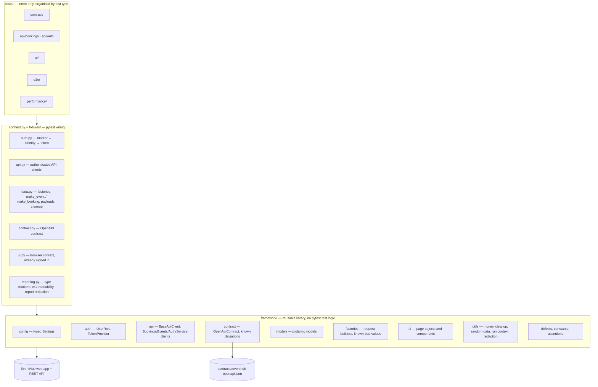

# EventHub — Booking Flow Test Automation (US-114)

UI and API test automation for the **"Book tickets for an event"** flow of
[EventHub](https://eventhub.rahulshettyacademy.com), built with **Python, pytest and Playwright**. Playwright drives
the browser *and* the REST API, and API responses are checked against EventHub's own OpenAPI spec.

| | |
|---|---|
| **Scope** | US-114, AC1–AC5: create a booking, total price, My Bookings, cancellation, and the same through `POST /api/bookings` |
| **Suite** | 136 functional tests: **29 contract · 88 API · 16 UI · 3 E2E**, plus **6 performance** tests (opt-in). Every story test is tagged with the acceptance criteria it covers |
| **Live result** | **Functional: 123 passed, 13 xfailed, 0 failed** in ~79 s with `-n 3`; every acceptance criterion AC1–AC5 covered with no failures. The 13 xfails are the suite reproducing the 8 defects EH-01…EH-08 (§3). **Performance: 6/6 within budget** (p95 200–435 ms, last measured) |
| **Stack** | Python ≥ 3.10 · pytest 9 · Playwright 1.63 (`pytest-playwright`) · pydantic 2 · openapi-schema-validator · pytest-xdist · pytest-html |
| **Auth** | Handled entirely by the framework. Tests declare *who* they act as, never *how* to log in |
| **CI (bonus)** | GitHub Actions on every push and pull request: lint → type-check → collect → contract + API → UI + E2E |

## Contents

1. [How to run](#1-how-to-run)
2. [Story review (US-114)](#2-story-review-us-114)
3. [Defects found](#3-defects-found)
4. [What is tested, and why](#4-what-is-tested-and-why)
5. [Test architecture](#5-test-architecture)
6. [Key decisions and trade-offs](#6-key-decisions-and-trade-offs)
7. [Continuous integration](#7-continuous-integration)
8. [What I would do with more time](#8-what-i-would-do-with-more-time)
9. [Troubleshooting](#9-troubleshooting)

---

## 1. How to run

**Prerequisites:** Python **3.10+** (verified with 3.11, 3.12 and 3.13) and two EventHub accounts
(register at <https://eventhub.rahulshettyacademy.com/register>). The second account is used only by the
tests proving one user can't reach another user's bookings; they are skipped, with the reason shown, if it isn't configured.

> **Reviewers:** the credentials of both test accounts are in the submission form. They are deliberately not committed.

**Install** (inside the project folder):

```powershell
# Windows (PowerShell)
python -m venv .venv
.\.venv\Scripts\Activate.ps1
pip install -r requirements.txt
python -m playwright install chromium
Copy-Item .env.example .env      # then fill in the two accounts
```

```bash
# macOS / Linux (Git Bash on Windows: source .venv/Scripts/activate)
python3 -m venv .venv && source .venv/bin/activate
pip install -r requirements.txt
python -m playwright install chromium
cp .env.example .env             # then fill in the two accounts
```

`.env` is git-ignored; the same variables can be real environment variables, which is how CI supplies them.

| Variable | Required | Purpose |
|---|---|---|
| `EVENTHUB_PRIMARY_EMAIL` / `EVENTHUB_PRIMARY_PASSWORD` | yes | Main test user |
| `EVENTHUB_SECONDARY_EMAIL` / `EVENTHUB_SECONDARY_PASSWORD` | for the isolation tests | A second user, to prove user B can't see or change user A's bookings |
| `EVENTHUB_BASE_URL` / `EVENTHUB_API_URL` | no | Another deployment (defaults to the public one) |
| `EVENTHUB_DATA_SEED` | no | Replay a failed run's generated data (the seed is printed in the report header, §5.5) |
| `EVENTHUB_RUN_ID` | no | Label for the data a run creates (generated if unset; CI passes its own) |

**Run:**

```bash
pytest -n 3                      # functional suite: contract + API + UI + E2E (max 4 workers, §5.4)
pytest -m api                    # REST API only (no browser)
pytest -m "ui or e2e"            # browser tests only
pytest -m ac2                    # everything covering acceptance criterion AC2 (ac1…ac5)
pytest -m negative               # error paths and invalid input
pytest -m e2e --headed --slowmo 300   # watch the journeys
pytest -m performance            # latency budgets (opt-in, never in the default run)
```

| Output | Where |
|---|---|
| Console | Run id and data seed in the header, results, and a **US-114 traceability matrix** (AC → passed / failed / xfailed) |
| HTML report | `reports/report.html` (with an "Acceptance" column) |
| JUnit XML | `reports/junit.xml` (each test carries `story` / `acceptance` properties) |
| Failure artefacts | `test-results/<test>/trace.zip` and screenshots: `playwright show-trace <path>` |

---

## 2. Story review (US-114)

> *As a visitor to EventHub, I want to book tickets for an event so that I can attend it.*
> AC1 booking created + confirmation with reference · AC2 total = price × tickets · AC3 appears in My Bookings · AC4 I can cancel a booking · AC5 the same works through `POST /api/bookings`.

**Verdict:** the happy path is clear, but the story is not testable as written in several places: no input
rules, no limits, no failure behaviour, no ownership rules, and one contradiction with the product
("visitor" vs. mandatory sign-in). AC4 and AC5 are too vague to have a single correct implementation.

### 2.1 What is missing, unclear or wrong, and what I'd ask the Product Owner

| # | Where | Observation | Question for the PO |
|---|---|---|---|
| 1 | Persona | **Wrong.** "As a *visitor*" implies an anonymous user, but booking requires an account: the UI redirects to `/login` and every booking endpoint returns `401` without a token. | Should guests be able to book? If not, can the persona be "registered user"? |
| 2 | AC1 inputs | **Missing validation rules.** Nothing defines a valid name, e-mail or phone, or which fields are mandatory. The UI enforces name ≥ 2 chars, an e-mail regex and **≥ 10 digits** for the phone; the API docs say phone `minLength: 10` **characters**. | What are the rules per field? Which phone formats are valid? What are the maximum lengths? |
| 3 | AC1 quantity | **Missing limits.** The implementation allows 1–10 tickets per booking, further capped by the seats left. | Is 10 a business rule? Per booking or per customer? |
| 4 | AC1 failure paths | **Missing.** No behaviour for sold-out events, too few seats, or two people buying the last seat. The app shows "Sold Out"; the API returns `400 "Only N seat(s) available…"`. | What should the user see? Is overbooking acceptable under concurrency? |
| 5 | AC1 reference | **Unclear.** No format, uniqueness or delivery rule. The API docs promise `EVT-` + 6 characters; live references look like `Q-MWTERP` (**EH-02**). | Is the format a contract? Must it be unique? Is it e-mailed? |
| 6 | AC1 event state | **Missing.** Can past events, or events not yet on sale, be booked? | Which events are bookable? |
| 7 | AC2 money | **Unclear.** No currency, rounding, fees, taxes or discounts. The UI shows **USD with no decimals** while the content is India-centric (+91 phones, Indian cities); fractional prices show wrong totals (**EH-01**). | Which currency, how many decimals, any fees or taxes? |
| 8 | AC3 | **Unclear.** Which fields, order and paging? The environment also caps a sandbox at 9 bookings and silently drops the oldest, so a booking can *disappear* from My Bookings. | Which fields and order? Is silently evicting a customer's booking acceptable? |
| 9 | AC4 | **Too vague.** Which bookings can be cancelled (only your own?), until when, with what refund (the UI has a hidden rule: single-ticket bookings refundable, group bookings not), partial cancellation, and whether seats return to sale. | Cancellation policy, cut-off, refunds, partial cancellation, seat release? |
| 10 | AC4 vs data | **Contradictory docs.** `DELETE /bookings/{id}` "cancels (permanently deletes)", yet the schema has a `cancelled` status and `GET /bookings?status=cancelled` exists. | Soft cancel (keep history) or hard delete? |
| 11 | AC5 | **Too vague.** Only `POST` is named. Do AC3 and AC4 apply to the API too? What is the error contract? | Which API operations are in scope, with which error responses? |
| 12 | Missing NFRs | Nothing on **authorization** (bookings hold personal data), double-submit, concurrency, accessibility, confirmation e-mail, time zones, or **what happens to sold seats when an organiser changes an event's capacity**. | Can these become explicit criteria? (Authorization and the capacity case are tested anyway, §4.) |

### 2.2 Assumptions I made to keep going

* **A1** — "Visitor" means a **signed-in** user (that is what the product does).
* **A2** — AC3 and AC4 also apply to the API, so the API suite covers create, list, get and cancel.
* **A3** — Users can only read and change **their own** bookings (the docs promise "a fully isolated sandbox").
* **A4** — Cancelling releases the seats (documented) and removes the booking from My Bookings ("permanently deletes").
* **A5** — Money is exact: `total = unit price × quantity`, no float drift, and the screen shows that value.
* **A6** — An event never sells more tickets than it has seats, even after its capacity changes (undocumented; violated live, **EH-06**).

### 2.3 Where the application or docs don't match the story (or each other)

| # | Finding | Evidence |
|---|---|---|
| D1 | Swagger declares **no security** on `/bookings` and `/events` and documents no `401`; every call without a token returns `401`. | Probed live → **EH-04** |
| D2 | **Undocumented endpoint** `DELETE /api/bookings` ("Clear all bookings" on My Bookings). | It answers `401`, not `404`, and the UI calls it |
| D3 | `DELETE /bookings/{id}` "permanently deletes" vs. the `cancelled` status and filter. | OpenAPI spec |
| D4 | The booking details page handles **`403 Access Denied`**, but the docs list only `200/404/500`. | Web-app source; the isolation tests accept 403 *or* 404, never 200 |
| D5 | **Sandbox caps** (9 bookings, 6 custom events, oldest silently replaced) appear in the UI but not in the API docs, and conflict with AC3. | Events page banner; the framework is built around them (§5.4) |
| D6 | **Password policy**: API docs `minLength: 6` vs. register page "Min 8 chars, uppercase, number & symbol". Settling it would create permanent accounts, so it is reported, not tested. | OpenAPI vs. register form |
| D7 | **Phone rule**: UI ≥ 10 *digits*, API docs `minLength: 10` *characters*. | UI source vs. OpenAPI |
| D8 | **Currency and rounding** undefined; the UI shows `$` with 0 decimals. | UI source → **EH-01** |
| D9 | A **refund rule** in the UI is in neither the story nor the docs. | Booking details page |
| D10 | **Booking reference** format differs from the docs. | Live → **EH-02** |
| D11 | **Money is a JSON string** (`"totalPrice": "2500"`); the docs say `number`. | Live → **EH-03** |
| D12 | `POST /bookings` **400 response is `oneOf` two overlapping schemas**, so no error body can validate. | Contract layer → **EH-05** |
| D13 | The docs say login answers **`404 "User not found"`** for an unknown e-mail (account enumeration). Live, an unknown e-mail and a wrong password get the **same** `400`, which is the secure behaviour; only the docs are wrong. | `test_login_does_not_reveal_whether_an_account_exists` |
| D14 | **Undocumented fields** (`userId`, `isStatic`). | Live responses |
| D15 | The docs type `customerName`/`customerPhone` as strings and `quantity` as an integer, but the API **converts** wrong types instead of rejecting them. | Live → **EH-07** |
| D16 | **No maximum length** is documented for any text field, yet a 1,000-character name crashes the API. | Live → **EH-08** |

---

## 3. Defects found

**Eight defects: 1 high, 1 medium, 6 low.** Each is reproduced by a strict known-defect test (§5.6), so the run stays green while it exists and turns red the day it is fixed.

| ID | Severity | Summary | Evidence | Test |
|---|---|---|---|---|
| **EH-01** | Medium | **The UI rounds amounts to whole dollars**, so totals for fractional prices are wrong and contradict each other. | Price $1,499.50 × 3: the summary shows "$1,500 × 3 tickets" and a total of "$4,499"; the real amount is $4,498.50. Cause: `Intl.NumberFormat(…, {maximumFractionDigits: 0})`. The API stores the exact amount. | `ui/test_booking_price_display.py` |
| **EH-02** | Low (contract) | **Booking references don't follow the documented `EVT-XXXXXX` format.** | Live `"bookingRef": "Q-MWTERP"`; the docs promise `EVT-XXXXXX`. | `contract/test_bookings_contract.py::test_booking_reference_follows_documented_format` |
| **EH-03** | Low (contract) | **Money amounts are JSON strings, not numbers.** | `"totalPrice": "2500"`, `"price": "1250"`; the spec says `number`. | `contract/…::test_booking_total_price_is_a_json_number`, `test_event_price_is_a_json_number` |
| **EH-04** | Low (docs) | **The spec documents no authentication** for `/bookings` and `/events` (no `security`, no `401`). | Every call without a token returns `401`. | `contract/test_bookings_contract.py::test_unauthenticated_responses_are_documented` |
| **EH-05** | Low (docs) | **`POST /bookings` 400 response is unsatisfiable** (`oneOf` of two open schemas). | Every real 400 body matches both, so `oneOf` never holds. Fix: `anyOf` or a discriminator. | `contract/test_bookings_contract.py::test_rejected_booking_response_matches_contract` |
| **EH-06** | **High** | **Changing an event's capacity never adjusts its available seats, so it can be oversold.** | 10 seats, 4 sold. `PUT /events/{id}` with `totalSeats: 3` → **200**; available seats stay **6**; one more booking → **201**: **5 tickets for a 3-seat event**. Expected: reject a capacity below the seats sold, and recompute available seats. | `api/bookings/test_booking_seat_inventory.py::test_tickets_sold_never_exceed_capacity_after_the_event_is_resized` |
| **EH-07** | Low (contract) | **`POST /bookings` converts values of the wrong JSON type instead of rejecting them.** | `customerName: 12345` / `true` → **201**, stored as `"12345"` / `"true"`; `customerPhone: 9876543210` (number) → stored as text; `quantity: "2"` (text) → stored as `2` and charged for 2 tickets. Values that can't convert are rejected. | `api/bookings/test_booking_validation.py::test_field_of_the_wrong_type_is_rejected` (4 cases) |
| **EH-08** | Low | **A 1,000-character customer name crashes `POST /bookings` with HTTP 500** instead of a validation error. | → **500** `{"error":"Internal server error"}`; nothing leaks and no seats are consumed. No length limit is documented (D16). | `api/bookings/test_booking_validation.py::test_unusual_customer_name_is_stored_exactly_or_rejected_cleanly[too-long]` |

The inconsistencies in §2.3 (D1–D16) should be raised with the team too: not all are product defects, but each is a question someone would otherwise answer differently.

---

## 4. What is tested, and why

**Strategy (risk-based).** Breadth through the API, where rules with many variants are cheap to test exactly;
user journeys through the browser; and cross-layer checks, so a correct-looking confirmation screen can't hide a wrong stored booking.

* **API (88):** the booking rules behind every AC: creation (AC1, AC5), exact totals (AC2), listing and lookup (AC3), cancellation with seat release (AC4), seat inventory, input validation, and **access control** (bookings hold personal data). Plus `/auth`, which every booking depends on.
* **Contract (29):** every booking response matches the published spec, so API clients and the web app can rely on it; the same check for the `/events`, `/auth` and service calls the flow uses, and a check that the published spec hasn't changed.
* **UI (16):** what only a browser can prove: what the user sees (totals, My Bookings card, access denied) and what the form prevents before anything is sent.
* **E2E (3):** the AC1–AC4 journeys as a user lives them, confirmed through the API. Few on purpose: slowest and most fragile layer, so they cover journeys, not rules.
* **Performance (6, opt-in):** latency budgets for the calls the booking flow makes; report-only, never a load test on a shared environment.
* Data-driven parametrisation keeps one test per *rule*; a new validation case is a one-line change.

### 4.1 Inventory

| File | Tests | Covers | What it proves |
|---|---|---|---|
| **api/bookings/** | | | |
| `test_booking_create.py` | 2 | AC1, AC5 | 201, "Booking confirmed!", confirmed status, stored data equals what was sent; the reference resolves to this booking; references are unique |
| `test_booking_total_price.py` | 6 | AC2, AC5 | **total = price × qty** for 1, 4 and 10 tickets, exact for fractional prices (0.10, 19.99, 1499.50) |
| `test_booking_seat_inventory.py` | 4 | AC5 | Booking consumes seats; the last seats can be booked; overbooking is rejected and consumes nothing; never oversold after a capacity change (**EH-06**) |
| `test_booking_retrieve.py` | 3 | AC3, AC5 | Listed (filtered by event); fetched by id and by reference; unknown reference → 404 |
| `test_booking_cancel.py` | 4 | AC4, AC5 | Cancel releases the seats; the booking is gone; cancelling twice or an unknown id → 404 |
| `test_booking_validation.py` | 42 | AC5 | Each invalid value, missing field and **wrong JSON type** → `400` naming the field, **no seats consumed** (**EH-07**); unusual but legitimate names stored exactly or rejected cleanly, never a 5xx (**EH-08**); unknown event → 404 |
| `test_booking_access_control.py` | 12 | A3 | Every booking endpoint requires auth; bad and forged tokens rejected; user B can't read, list, cancel or book against user A's data |
| **api/auth/** | | | |
| `test_auth_login.py` / `test_auth_me.py` / `test_auth_register.py` | 15 | – | Login returns a working token for the right user; no account enumeration (D13); invalid tokens → 401; malformed input → 400; existing e-mail refused (negative paths only, §4.2) |
| **contract/** | | | |
| `test_bookings_contract.py` | 12 | AC1–AC5 | Every booking response matches the spec; strict checks pin **EH-02, EH-03, EH-04, EH-05** |
| `test_events_contract.py` / `test_auth_contract.py` / `test_service_contract.py` | 16 | – | The event, auth and service responses the flow relies on match the spec (event `price` type: **EH-03**) |
| `test_openapi_drift.py` | 1 | – | The live spec is still the versioned one; lists what changed if not |
| **ui/** | | | |
| `test_booking_form_validation.py` | 6 | AC1 | Empty form shows all errors and **sends no request**; 5 invalid inputs are blocked in the browser |
| `test_booking_form_quantity.py` | 3 | AC1 | Quantity limited to the seats left and capped at 10; sold-out events can't be booked |
| `test_booking_price_display.py` | 2 | AC2 | The live total follows the ticket count; fractional prices display exactly (**EH-01**) |
| `test_my_bookings_display.py` | 2 | AC3, AC4 | The card shows title, tickets, total, status; dismissing the cancel dialog keeps the booking |
| `test_booking_access_control.py` | 1 | A3 | User B opening user A's booking sees "Access Denied", with none of A's data |
| `test_event_filter_options.py` | 2 | – | The city and category lists the suite books against are still the ones the app offers (§5.7) |
| **e2e/** | | | |
| `test_booking_journey.py` | 2 | AC1–AC3, AC5 | **Events → search → Book Now → 3 tickets + details → confirmation → verified via API → My Bookings**; seats go down |
| `test_booking_cancel_journey.py` | 1 | AC4 | Cancel from My Bookings → confirmation → card gone → API 404 → seats restored |
| **performance/** | | | |
| `test_api_latency.py` | 6 | – | p95 of the booking flow's API calls within budget |

### 4.2 Deliberately not automated

| Area | Reason |
|---|---|
| Event management (`/events` create, update, delete, search) | Outside the booking flow. The suite uses `/events` only to set up data; the one consequence for bookings, overbooking after a capacity change (**EH-06**), is tested. |
| Successful registration; password policy (D6) | There is no account-deletion endpoint, so each run would leave permanent accounts on a shared environment. |
| Login / register **UI** | Not part of US-114; browser tests start signed in (§5.3). A UI login smoke test would be next. |
| "Clear all bookings" (`DELETE /bookings`) | Wipes the whole sandbox (unsafe with parallel tests) and is undocumented (D2). |
| Refund widget; sandbox-cap eviction | Rules outside the story (D9, D5); they need PO confirmation, and testing eviction would break concurrent tests. |
| Concurrency (two users racing for the last seat) | Needs a dedicated, serialised test and PO input (§2.1 #4). |
| Load / stress testing | Not ours to do on a shared public environment. |

---

## 5. Test architecture

### 5.1 Principles

* **Tests express intent, not mechanics.** Selectors, URLs, headers, tokens and JSON live in the framework.
* **Authorization belongs to the framework.** No test logs in, holds a credential or sets a header (only the auth tests see credentials, because authentication is their subject).
* **Every test owns its data**: it creates what it needs through the API, so prices and seat counts are exact, and deletes it afterwards. No test depends on another or on run order.
* **Structure says what a test is**: the folder is the test type, the file is one behaviour (`test_<resource>_<behaviour>.py`), the name is the expected outcome.
* **Verify across layers**: browser actions are confirmed through the API.
* **Fail diagnostically, never leak secrets**: a failure carries the full HTTP exchange or a Playwright trace, with passwords and tokens masked.

### 5.2 Layers and structure



```
.
├── conftest.py                     # registers the fixture plugins; run id + data seed for every worker
├── contracts/eventhub-openapi.json # versioned copy of the live OpenAPI spec
├── fixtures/                       # auth, api, data, contract, ui, reporting (pytest wiring only)
├── framework/
│   ├── config/   auth/   api/      # settings · UserRole, TokenProvider · BaseApiClient, one client per resource
│   ├── contract/ models/           # spec validation · pydantic models and request dataclasses
│   ├── factories/                  # EventFactory, BookingFactory, invalid_data (known-bad values)
│   ├── ui/                         # EventHubApp, pages/, components/
│   ├── utils/                      # money, cleanup, random_data, run_context, redaction, latency
│   └── constants.py  defects.py  assertions.py
├── tests/
│   ├── api/bookings/  (73)   api/auth/  (15)
│   ├── contract/  (29)   ui/  (16)   e2e/  (3)   performance/  (6)
├── .github/workflows/tests.yml
└── pyproject.toml · requirements*.txt (exact pins) · .env.example
```

Dependencies only point downwards; `framework/` has no test logic and could serve another runner.

### 5.3 Authorization is handled by the framework

A test declares an identity with a marker; everything else follows.

```python
def test_x(api, page): ...                 # default: primary user, in the API client and the browser

@pytest.mark.as_user("secondary")
def test_y(api, page): ...                 # the other user, in both layers

@pytest.mark.anonymous
def test_z(api): ...                       # no credentials at all

def test_isolation(api, other_user): ...   # two identities in one test
```

* `TokenProvider` logs each role in **once per worker** through `POST /auth/login`, caches the JWT and logs in again shortly before it expires. A rejected login is remembered, so a wrong password can't trigger a lock-out.
* API clients get the token as an `Authorization` header; the browser gets the **same** token through Playwright `storage_state` (`localStorage["eventhub_token"]`, as the app's own login does), so every UI test opens the app already signed in.
* A missing primary account **stops the run once** with an actionable message; a missing secondary account **skips** only the isolation tests.

### 5.4 Test data and cleanup

* `event` / `make_event(...)` create a **fresh event per test** (price 1250, 50 seats unless overridden), so totals and seat counts are exact and tests run in any order or in parallel. `make_booking(...)` creates a confirmed booking.
* Everything created is tracked and deleted at teardown by its owner, in reverse order; cleanup problems are warnings, never failures that hide the real result.
* Data is obviously synthetic: event titles start with `QA-AUTO <run id>`, e-mails use the reserved `example.com` domain. Nothing permanent is created (registration is tested on negative paths only).
* The sandbox caps (9 bookings / 6 events per user, oldest silently replaced) are why tests keep at most 2 bookings and 2 events alive, and why parallelism is **capped at 4 workers** per account.

### 5.5 Generated data: factories, seeds, negative data

* **Factories** (`framework/factories/`) build valid request bodies; any field can be overridden (`booking_factory.build(event.id, quantity=3)`), and a mistyped field fails instead of being ignored. They take their random values from an injected source, so they stay simple and testable.
* **Reproducible data.** All generated values come from a seeded `random.Random` (Faker seeded from it). Each test's data derives from the run's **data seed** and the test's id, so a failed test can be replayed with exactly the same data: take `eventhub data seed: …` from the report header and run `EVENTHUB_DATA_SEED=<seed> pytest "<test id>"`. Event titles also carry the run id, so a replay never collides with the original run's data.
* **Negative data.** Validation tests start from a valid body as a plain dict (`booking_payload` / `event_payload`) and break it: `booking_payload.pop("customerEmail")` or `booking_payload["quantity"] = None`. This reaches what overrides can't (missing fields, wrong JSON types). The known-bad values live once, in `framework/factories/invalid_data.py`. Where the docs define a rule, the test asserts `400` naming the field and no seats consumed; where they don't (length, character set), it accepts either outcome but demands a clean one: stored exactly, or rejected with a 400, never a 5xx (that is how EH-08 surfaced).

### 5.6 Contract layer and known defects

* `OpenApiContract.assert_conforms(response, "POST", "/bookings")` checks that the status code is documented for the operation and that the body validates against the documented schema, listing every violation in one failure. The spec is a versioned copy (`contracts/`), so contract changes are reviewable diffs; a drift test fails the day the published spec changes (`--update-openapi-snapshot` refreshes it after review).
* `@known_defect("EH-06")` marks a test that reproduces a registered defect as a **strict xfail that only accepts `AssertionError`**: while the defect exists the run stays green; once it's fixed the test passes unexpectedly and fails the run, so the fix is noticed; any other error (timeout, failed setup) still fails, so the marker can't hide unrelated breakage.

### 5.7 HTTP layer, secrets and shared values

* **API** calls go through Playwright's `APIRequestContext` (one tool for UI and API). The HTTP verb is normalised once; a dropped connection is retried by **Playwright's built-in `max_retries`**, for idempotent methods only, **never for `POST`** (a lost response must not double-book); error statuses are never retried.
* **Secrets** (`framework/utils/redaction.py`): passwords and tokens are held as `SecretStr`, registered when they enter the process, and masked at every exit (assertion messages, errors, logs and every test report), together with anything token-shaped or under a credential-like key.
* **UI** uses **page objects** composed of **components** behind one facade (`app.event_details.open(event.id).booking_form.book(...)`); tests assert with Playwright's auto-waiting `expect`, never sleeps. Locators: `data-testid` first, then role/label/text.
* **Shared values** are defined once in `framework/constants.py` (ticket cap, cities, categories, sandbox caps). The cities and categories mirror the product, so `test_event_filter_options.py` and a contract test fail if the app's lists change.

### 5.8 How to extend

| To add… | Do this |
|---|---|
| a test | Put it in the folder of its type, in the file of its behaviour (or a new `test_<resource>_<behaviour>.py`); tag story tests with `@pytest.mark.acceptance("AC…")`. |
| an API / UI test | Use `api` or `app` with `event` / `make_event` / `make_booking`; act through clients or page objects; assert with `expect_status` / `expect`. |
| a negative case | Take `booking_payload`, `pop` a field or set a value from `invalid_data.py`. |
| an endpoint / page | Add a method to the resource client, or a page object under `framework/ui`. |
| a persona | Add a `UserRole` member and its two settings, then `@pytest.mark.as_user("…")`. |
| an environment | Set `EVENTHUB_BASE_URL` / `EVENTHUB_API_URL`; no code changes. |
| a known defect | Register it in `framework/defects.py` and mark the reproducing test `@known_defect("EH-xx")`. |

---

## 6. Key decisions and trade-offs

| Decision | Why | Trade-off |
|---|---|---|
| **Python + pytest + Playwright for both layers** | One language, runner and tool; pytest fixtures are a natural dependency-injection system | `requests`/`httpx` would also suit the API layer |
| **Auth by token + `storage_state`, identity by marker** | Fast, deterministic, declared in the test, one mechanism for API and UI | The login form itself isn't covered (outside US-114) |
| **A fresh event per test** | Exact price and seat assertions; no interference between tests or people | Two extra API calls per test |
| **Folders by test type, one behaviour per file** | The structure tells a newcomer what each test proves; reports group by behaviour; CI can gate per type | A behaviour can appear in several folders (same file name per layer) |
| **Contract tests against a versioned copy of the real spec** | Models can't drift from the spec; spec bugs (EH-04, EH-05) surface | Spec changes need a reviewed snapshot update |
| **Strict xfail for known defects** | The run stays green, the defect stays visible, a fix is detected automatically | A small registry to maintain |
| **Seeded, per-test data; negative data by dict mutation** | Any failure can be replayed exactly; missing fields and wrong types are testable | A replay can't reproduce server-assigned ids or dates relative to *now* |
| **No test re-runs; connection retries for idempotent calls only** | Re-runs hide flakiness and defects; `POST` must never be repeated | A dropped `POST` still fails the run (CI re-run is one click) |
| **Layered secret redaction at every exit** | A report can never carry a password or token, whatever code produced it | Over-masks slightly; Playwright traces of failed UI tests still hold the session token (private CI artifacts, 14 days) |
| **≤ 4 parallel workers, queued CI runs** | Respects the sandbox caps | Throughput bounded per account (§8) |
| **Performance opt-in and report-only** | Catches latency regressions without loading a shared environment | Not a capacity test |
| **Exact dependency pins** | Reproducible local and CI runs | Needs periodic upgrades |

---

## 7. Continuous integration

`.github/workflows/tests.yml` runs on every **push** and **pull request**, nightly, and on demand.

1. **static-checks**: `ruff`, `mypy`, each framework module imported on its own (catches circular imports), and test collection: import, marker and fixture errors in seconds, without credentials.
2. **functional**: contract + API, then UI + E2E, as separate steps with separate reports (the second runs even if the first fails). Traceability matrices go to the run summary; reports and traces are uploaded (14 days).
3. **performance** (nightly or on request): non-blocking, latency table on the run summary.

Setup: add four repository secrets: `EVENTHUB_PRIMARY_EMAIL`, `EVENTHUB_PRIMARY_PASSWORD`, `EVENTHUB_SECONDARY_EMAIL`, `EVENTHUB_SECONDARY_PASSWORD`. Runs are queued (`concurrency`) because they share the same sandboxes. Each pipeline labels its data with its run id and uses one data seed, so a failed pipeline's data can be replayed (*Run workflow* → `data_seed`).

---

## 8. What I would do with more time

1. **Get answers to §2.1** and turn them into acceptance criteria and tests (soft vs. hard cancel, currency, limits, cancellation policy, capacity changes).
2. **Concurrency test** for the last seat (parallel `POST /bookings`), to check that no overbooking happens.
3. **An account per worker**, removing the 4-worker cap and the sandbox-cap constraints.
4. **One UI login smoke test**, and registration tests against a disposable environment where accounts can be deleted.
5. **Cross-browser** (Firefox, WebKit) and a mobile viewport nightly; **accessibility** checks (axe-core) on the booking form and My Bookings.
6. **Property-based fuzzing** of `POST /bookings` from the spec (Schemathesis).
7. **Unit tests for the framework** itself (redaction, retry policy, factories), and **trend reporting** (Allure) for flaky-test detection.
8. **A test-data janitor** that deletes `QA-AUTO` leftovers of runs killed mid-way.

---

## 9. Troubleshooting

| Symptom | Fix |
|---|---|
| `No credentials configured … Nothing was run.` | Create `.env` from `.env.example` in the project folder, or export the variables. |
| `… is not an e-mail address` | A placeholder is still in `.env`; use the real address of a registered account. |
| `Login failed … HTTP 400` | Wrong password or missing account; log in once by hand. Put passwords in single quotes in `.env`. |
| Isolation tests **skipped** | The secondary account isn't configured (expected; add it to run them). |
| `-n 5 is not allowed` | Intentional (sandbox caps): use `-n 4` or fewer. |
| Need a failed test's exact data | `EVENTHUB_DATA_SEED=<seed from the report header> pytest "<test id>"`. |
| `The live OpenAPI spec changed: …` | Review the changes, then `pytest tests/contract/test_openapi_drift.py --update-openapi-snapshot` and commit. |
| `bash: .venvScriptspython: command not found` | Git Bash needs forward slashes: `.venv/Scripts/python`. |
| UI failure | `playwright show-trace test-results/<test-folder>/trace.zip`. |
